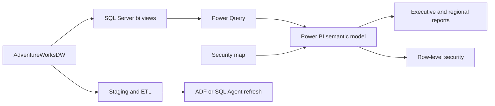

# DA-01 — Enterprise Business Intelligence Suite

A multi-region business intelligence solution designed to bring sales, finance, HR and supply chain reporting into a unified Power BI environment, with region-based access control for business users.

## Features
- SQL Server star-schema views built around sales, finance, inventory and sales quota data.
- Power Query transformation steps for cleaning and shaping source data.
- DAX measures and a semantic model for consolidated business reporting.
- Regional row-level security using a security mapping table and the signed-in user's identity.
- Executive and regional reporting workflows, including drill-through analysis.
- SQL-based staging and refresh procedure, with Azure Data Factory and SQL Server Agent implementation options.
- Data quality, DAX, row-level security and performance test documentation.

## Architecture
The solution uses AdventureWorksDW as its sample source. SQL Server provides the reporting views and staging layer; Power Query prepares the data for the Power BI semantic model; DAX measures support reporting; and the security map applies region-level filtering.

## Data model
- **Fact tables:** FactSales (Internet and Reseller), FactFinance, FactInventory and FactSalesQuota.
- **Dimensions:** DimDate, DimRegion, DimProduct, DimEmployee, DimAccount and DimScenario.
- **Security:** bi.SecurityMap maps user email addresses to permitted regions.

## Repository contents
- `sql/01_star_schema_views.sql` — reporting views, security map, ETL fallback procedure and data quality checks.
- `sql/02_sql_agent_job.sql` — SQL Server Agent scheduling option.
- `dax/measures.dax` — DAX measures and relationship specifications.
- `power_query_steps.md` — Power Query transformation guidance.
- `docs/test_plan.md` — data, DAX, RLS and performance test plan.
- `docs/user_guide.md` — end-user reporting guide.
- `docs/report_build_sheet.md` — page-by-page report build specification.
- `docs/diagrams/` — architecture and star-schema diagrams.
- `docs/final_presentation.pptx` — project presentation.
- `adf/` — Azure Data Factory pipeline assets and configuration notes.

## Setup
The project is designed for SQL Server with the AdventureWorksDW sample database and Power BI Desktop. The SQL scripts define the reporting layer and staging option; the Power Query, DAX and report documentation describe the semantic model and report configuration. Power BI Service refresh and role assignment require a separately configured workspace, credentials and gateway where applicable.

## Security and validation
The RegionManager and Executive roles are designed around the regional security mapping. The test plan documents validation scenarios for data quality, DAX calculations, row-level security and report performance. Actual test outcomes and service refresh evidence should be interpreted from the project evidence files; no live Power BI Service deployment is represented by this repository alone.

## Assumptions and limitations
- AdventureWorksDW is used as the primary sample source and represents historical sample data from approximately 2010–2014.
- FactFinance is keyed by Organization rather than sales region, so finance reporting is intended for executive-level visibility.
- AdventureWorksDW DimEmployee does not provide a reliable employee leaver flag; attrition analysis requires an additional HR dataset, such as the IBM HR sample dataset.
- Azure Data Factory and Power BI Service assets require environment-specific configuration and credentials before operational use.
