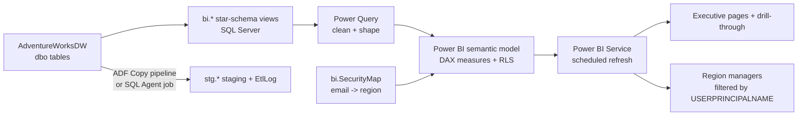

# Enterprise Business Intelligence Suite for a Multi-Region Company

One Power BI reporting system combining **sales, finance, HR and supply chain** data from AdventureWorksDW, with **row-level security** so each regional manager sees only their own region.

**Stack:** SQL Server · Power Query · DAX · Power BI Service · Azure Data Factory (or SQL Agent job fallback)

## Architecture



### Star schema
- **Facts:** `FactSales` (Internet + Reseller), `FactFinance`, `FactInventory`, `FactSalesQuota`
- **Dimensions:** `DimDate`, `DimRegion`, `DimProduct`, `DimEmployee`, `DimAccount`, `DimScenario`

## Repository layout
```
sql/01_star_schema_views.sql   star schema views, security map, ETL fallback proc, data quality checks
dax/measures.dax               all measures + relationship spec
docs/power_query_steps.md      Power Query shaping steps
docs/test_plan.md              data, DAX, RLS and performance tests with results table
docs/user_guide.md             one-page end-user guide
docs/schedule_and_presentation.md   9-day plan, presentation outline, reflection template
docs/evidence/                 screenshots (RLS tests, refresh history, performance)
```

## Setup
1. Install SQL Server (Developer/Express) and restore `AdventureWorksDW2022.bak` (Microsoft sample databases).
2. Run `sql/01_star_schema_views.sql` in the `AdventureWorksDW` database. Edit the emails in `bi.SecurityMap`.
3. Power BI Desktop: Get Data -> SQL Server -> import the `bi.*` views; follow `docs/power_query_steps.md`.
4. Create relationships and measures from `dax/measures.dax`.
5. Modeling -> Manage roles: create `RegionManager` and `Executive` (filters in `docs/test_plan.md`).
6. Publish -> Dataset settings: configure credentials/gateway, set scheduled refresh, assign users to roles.
7. Schedule `EXEC bi.usp_RefreshStaging` via SQL Server Agent (nightly) or build the equivalent ADF Copy pipeline.

## Key results (fill in with real numbers)
| Metric | Value |
|--------|-------|
| Sales reconciliation SQL vs Power BI | |
| RLS tests passed | /6 |
| Slowest visual (ms) | |
| Refresh duration | |

## Known limitations
- `FactFinance` is keyed by Organization, not sales region, so finance is shown to executives only.
- AdventureWorksDW `DimEmployee` has no reliable leaver flag; attrition uses the IBM HR dataset if added.
- Sample data covers roughly 2010-2014.

## Team / ownership
| Member | Owned |
|--------|-------|
| | |

## Additional files
- `docs/diagrams/` architecture and star schema (PNG + Mermaid source)
- `docs/report_build_sheet.md` page-by-page Power BI build instructions
- `docs/final_presentation.pptx` 10-minute deck (fill in the bracketed results)
- `sql/02_sql_agent_job.sql` and `adf/` data-movement options
